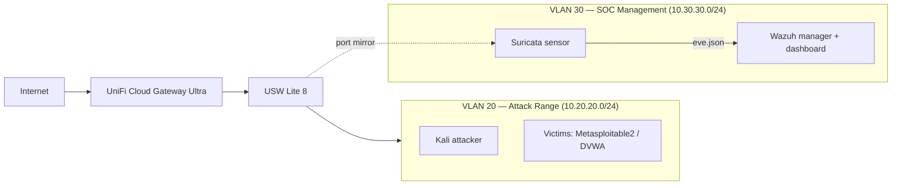

# Home SOC Lab

A self-built, network-segmented home Security Operations Center for practicing **detection engineering**, **network security monitoring**, and **incident response** against real attacks in a controlled environment.

> **Status:** Active build. The detection pipeline is complete and validated end to end, with the first ATT&CK-mapped detection (ICMP flood, T1498) fully documented. Additional detections are in progress; see [`ROADMAP.md`](docs/ROADMAP.md).

---

## Overview

This lab exists to demonstrate the work a SOC analyst actually does, which is interpreting what sensors produce, not just standing up infrastructure. Attacks are generated on one side and detected on the other through the same intrusion-detection-to-SIEM pipeline an enterprise relies on. Every rule, configuration, and investigation is version-controlled so detections are reproducible rather than one-time screenshots.

The lab runs on three mini-form-factor hosts virtualized with Proxmox, connected through UniFi networking that enforces VLAN segmentation under a default-deny policy. An attacker host launches attacks at deliberately vulnerable targets; a Suricata sensor inspects a passive mirror of that traffic; and a Wazuh SIEM decodes, correlates, alerts, and presents the results for triage.

## Architecture



Segmentation is a security control, not decoration. A default-deny firewall policy isolates the attack range from the SOC segment and the home network, and grants the SOC one-way visibility into the range. The attack range cannot initiate into the SOC segment, so a compromised target cannot reach the monitoring stack. The Suricata sensor sits out of band on a switch port mirror, inspecting a copy of the traffic without being in the path.

## What this demonstrates

- **Network segmentation and firewall policy** — VLAN design, zone-based rules, least privilege, and rule-ordering discipline verified with live hit counters.
- **Intrusion detection and network security monitoring** — Suricata deployment on a passive tap, custom signatures, and threshold tuning.
- **SIEM administration** — Wazuh log ingestion, custom rules and decoders, alert escalation, and dashboards.
- **Detection engineering** — custom rules mapped to MITRE ATT&CK, authored and version-controlled as detection-as-code.
- **Incident response and investigation** — alert triage, true-versus-false-positive analysis, post-incident log analysis with `jq` and network-flow correlation, and formal IR reporting.
- **Virtualization and Linux administration** — Proxmox VE, LXC and VM management.

## Detections

| ID | Detection | ATT&CK | Tactic | Data source | Status |
|----|-----------|--------|--------|-------------|--------|
| 01 | ICMP Flood (Denial of Service) | [T1498.001](https://attack.mitre.org/techniques/T1498/001/) | Impact | Suricata → Wazuh | Complete |

**Detection 01 — ICMP Flood** pairs a custom Suricata rate-threshold signature (`sid:1000020`) with a custom Wazuh escalation rule (`id 100700`) that raises the event to a level 12 alert tagged T1498. It was validated end to end, from launching the flood to the alert appearing in the dashboard, and the threshold was tuned against a real sensor constraint (packet loss on the capture tap) with before-and-after results recorded. The full detection writeup and incident-response report are in [`investigations and reports/`](<investigations and reports/>), the rules in [`detections/`](detections/).

Additional detections (SYN flood, HTTP flood, slow-rate, and Windows/Active Directory telemetry via Sysmon) are planned and tracked in [`ROADMAP.md`](ROADMAP.md).

## Repository structure

```
home-soc-lab/
├── README.md
├── ROADMAP.md                    # prioritized build-out plan
├── configs/                      # sanitized suricata.yaml, ossec.conf, network/firewall
├── detections/                   # custom Wazuh rules, Suricata rules
├── docs/                         # architecture, design decisions, lessons learned
├── investigations and reports/   # one writeup per detection, plus IR reports
├── mitre/                        # ATT&CK Navigator coverage layer
└── scripts/                      # sanitization and helper scripts
```

## Tech stack

| Layer | Tools |
|-------|-------|
| Virtualization | Proxmox VE 9 |
| Networking | UniFi Cloud Gateway Ultra, USW Lite 8 (VLANs, zone-based firewall, port mirroring) |
| Network IDS | Suricata |
| SIEM | Wazuh 4.14 (manager, indexer, dashboard) |
| Offensive | Kali Linux |
| Vulnerable targets | Metasploitable2, DVWA |
| Frameworks | MITRE ATT&CK + Navigator |

## Roadmap

The detection pipeline and the first detection are complete. Next, in priority order: a SYN flood detection (TCP protocol-state matching), an HTTP flood against DVWA (application-layer behavioral analysis), and a Windows domain with Sysmon to unlock host and Active Directory detections. Full detail in [`ROADMAP.md`](ROADMAP.md).

## Limitations

Stated plainly, because knowing the limits of your own tooling is part of the work:

- The lab currently covers **network detection**; host and Windows/Active Directory telemetry are the next build, not yet present.
- Monitoring is via a **passive port mirror on a USB 2.0 capture adapter**, which drops packets under heavy load, so detection thresholds are tuned to what the observation path actually delivers rather than to theoretical rates.
- Attacks are **single-source** (one attacker host), so this is DoS rather than DDoS; detections are written to still hold for the distributed case where possible.

---

*A personal learning and portfolio project. Built and maintained by [Chris Giamalis](https://github.com/ChrisGiamalis).*
